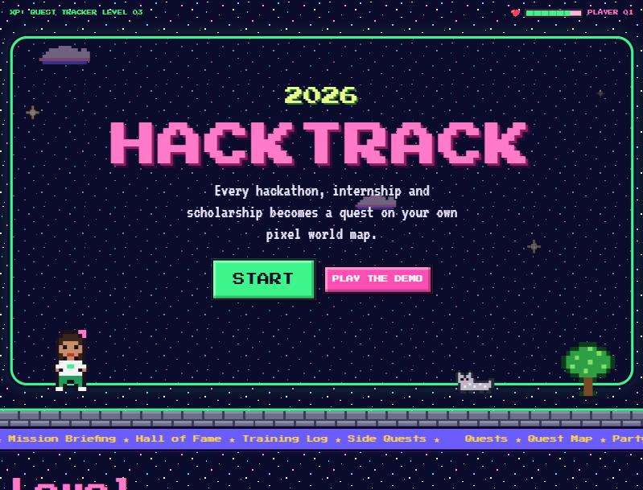
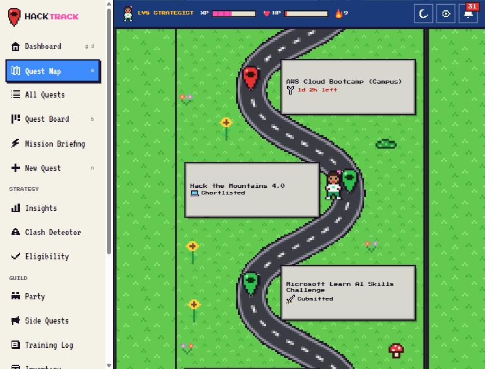
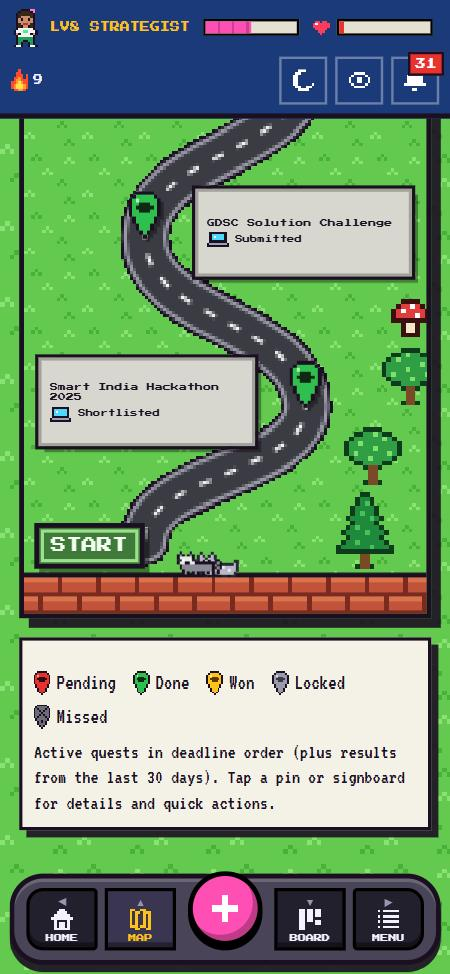
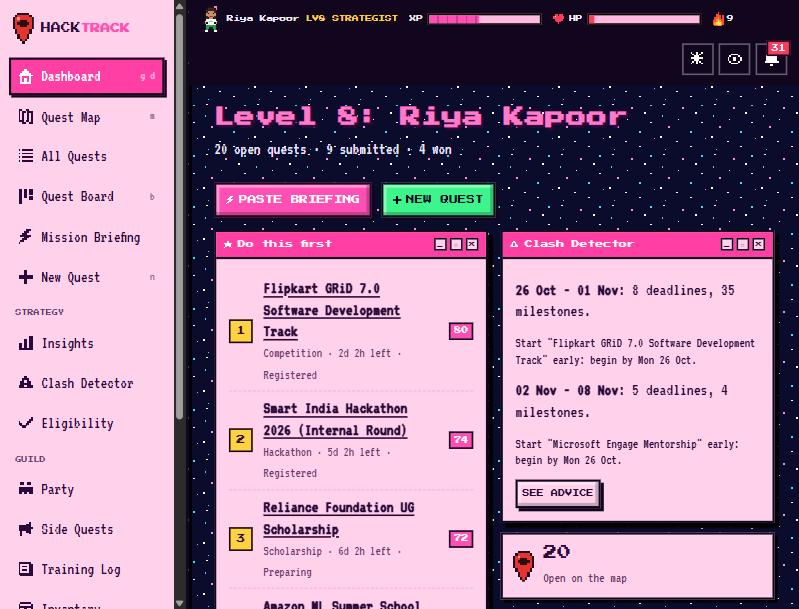
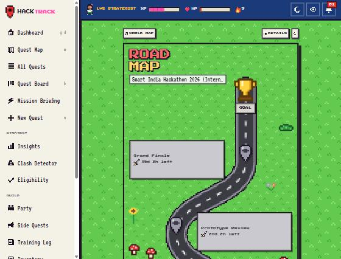
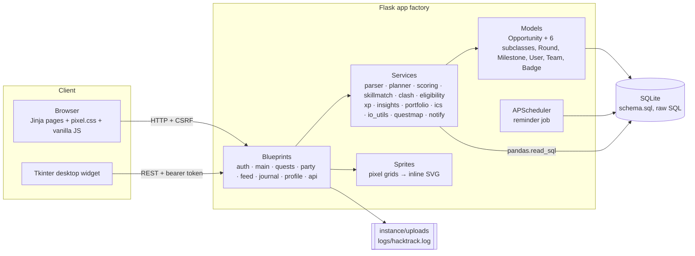

# HackTrack

**Track every hackathon, internship and scholarship as a quest on your own pixel world map.**

HackTrack is a retro-game styled opportunity tracker for college students. Paste a WhatsApp forward and it
becomes a quest; HackTrack tells you what to do first, plans milestones backwards from the deadline, warns
you about crowded weeks, checks eligibility, matches quests to your party's skills and turns your results
into LinkedIn-ready achievements. Built for a Python lab mini-project: Flask, raw SQLite, OOP, pandas,
NumPy, Matplotlib and a Tkinter desktop widget.

| Landing | Quest Map (day) | Mobile map |
|---|---|---|
|  |  |  |
| **Dashboard (night)** | **Quest Roadmap** | |
|  |  | |

> More placeholders: add your own captures to `docs/screenshots/` following `docs/SCREENS.md`
> (Insights, Kanban, Mission Briefing, Party, Hall of Fame, desktop widget).

## Quick start

```bash
pip install -r requirements.txt
```

```bash
python seed.py
```

```bash
python run.py
```

Open <http://127.0.0.1:5000> and log in with **`demo` / `demo1234`** (or press "Play the demo").

Optional desktop widget (keep the server running):

```bash
python desktop_widget.py
```

Run the tests:

```bash
python -m pytest
```

`python seed.py` **deletes and recreates** `instance/hacktrack.db` with the demo world (4 players, 31 quests
each, rounds, back-plans, a party, Side Quests, Training Log entries and a year of XP). Use
`python seed.py --keep` to add the demo world without wiping existing data.

## Features

**Core**
- Sign up, log in, "Create your player" onboarding (4 avatar looks, college, year, branch, skills, interests)
- Quests (opportunities) for 6 types with type-specific fields, tags, prize, team size, mode, eligibility, skills
- Status pipeline: Interested → Preparing → Registered → Submitted → Shortlisted → Won/Selected or Rejected/Missed,
  with a drag-and-drop Kanban board (plus keyboard-friendly dropdowns) and a list view
- Deadline dashboard with urgency colours, search, filters and sort

**Signature**
- **Mission Briefing**: paste-to-add parser with per-field confidence
- **Rounds** with their own deadlines, results and a timeline
- **Auto Back-Planner**: recursive, type-specific milestone trees dated backwards from the deadline
- **Team Skill-Match**: weighted Jaccard + proficiency coverage; gaps and who covers what
- **Portfolio generator**: LinkedIn bullets, resume section and About blurb (.txt / .md)
- **Insights**: pandas + NumPy + Matplotlib, Chart.js charts, 3 auto-generated insights, heatmap
- **Calendar export**: .ics per quest or for everything

**Extras**
- Priority score with breakdown + "Do this first"
- Clash Detector feeding the HUD's HP bar
- Eligibility checker
- Reminders at 7/2/1 days (APScheduler) with optional Telegram / email
- Badges, streaks, levels (Rookie → Challenger → Strategist → Champion → Legend)
- Public Hall of Fame at `/u/<username>` with privacy toggle
- Party boards with tasks per round and an activity log
- Side Quests college feed with upvotes and "Add to my quests"
- Training Log post-mortems with search and tags
- Inventory for links and uploaded files (5 MB, allowlisted types)
- CSV / JSON import-export with a validation report, rotating log file
- Read-only REST API with token auth

**Game layer**
- **Quest Map**: a scrollable pixel world (day and night) with a winding road, red map pins, signboards, trees,
  sunflowers, mushrooms, a cat and a raccoon; your avatar walks to the next pin when you finish one
- **Quest Roadmap** per quest ending at a trophy with a victory animation, XP and a badge
- XP for every action, persistent HUD with level, XP bar, streak flame and HP bar

**Accessibility and UX**: labels and focus rings, keyboard shortcuts (`/` search, `n` new quest, `b` board,
`m` map, `p` briefing, `?` help), Simple mode (no pixel effects), reduced-motion support, skeleton loaders,
confirm dialogs for every destructive action, toasts for every save, delete and error, empty states and
friendly 404/500 pages.

## Architecture



```
app/
  __init__.py        app factory, logging, error pages, HUD context
  db.py              sqlite3 helpers, init_db()
  models.py          OOP domain classes
  sprites.py         original pixel art -> SVG
  security.py        login_required, token_required
  blueprints/        routes
  services/          business logic (pure, unit tested)
  templates/         Jinja templates
  static/css|js|sprites
schema.sql  seed.py  run.py  desktop_widget.py  tests/  docs/  inspo/ (reference only, never served)
```

## Configuration

| Variable | Purpose |
|---|---|
| `SECRET_KEY` | **Set this in production.** Signs sessions and CSRF tokens. |
| `HACKTRACK_DB` | Database path (default `instance/hacktrack.db`) |
| `HACKTRACK_SCHEDULER` | `0` disables the APScheduler reminder job |
| `TELEGRAM_BOT_TOKEN` | Optional: send reminders to players who set a Telegram chat ID |
| `SMTP_HOST`, `SMTP_PORT`, `SMTP_USER`, `SMTP_PASSWORD`, `SMTP_FROM` | Optional: email reminders |
| `FLASK_DEBUG=1` | Debug mode for `run.py` |

Without the optional variables, reminders still appear in the in-app bell.

## Deployment

**Render**
1. Push the repo to GitHub and create a new *Web Service* on Render.
2. Build command: `pip install -r requirements.txt`. Start command: the `Procfile` line
   (`python seed.py --keep && gunicorn "app:create_app()" --workers 1 --bind 0.0.0.0:$PORT`).
3. Add `SECRET_KEY`. Render's free disk is ephemeral: the SQLite file resets on redeploy; attach a
   persistent disk and point `HACKTRACK_DB` at it to keep data.
4. Keep one worker so only one reminder scheduler runs.

**PythonAnywhere**
1. Upload or `git clone` the project, then `pip install --user -r requirements.txt` in a Bash console.
2. Run `python seed.py` once.
3. Web tab → *Manual configuration*; in the WSGI file add the project folder to `sys.path` and set
   `from app import create_app; application = create_app()`.
4. Set `SECRET_KEY` in the WSGI file (`os.environ["SECRET_KEY"] = "..."`) and map `/static/` to `app/static`.
5. Free accounts can't run background threads reliably: set `HACKTRACK_SCHEDULER=0`. Reminders are still
   created whenever a player opens the dashboard.

The seeded demo account has a public password and a fixed widget token; remove it (or skip `seed.py`)
for a real deployment.

## Docs for the college report

- `docs/CO_MAPPING.md`: every feature/file mapped to CO1-CO4
- `docs/SCREENS.md`: ordered screenshot list with paste-ready explanations
- `docs/REPORT_NOTES.md`: Aim, Problem Statement, Software Used, Conclusion
- `docs/SAMPLE_QUERIES.md`: SQL showcase with real output (`python docs/sample_queries.py`)
- `docs/TEST_RUN.txt`: latest `pytest -v` output

## LinkedIn project summary

> Built **HackTrack**, a gamified opportunity tracker for college students, as a Python lab project. Every
> hackathon, internship and scholarship becomes a quest on a pixel world map. It parses pasted WhatsApp/email
> text into structured quests, ranks them with a transparent priority score, auto-generates back-plans from
> deadlines, detects deadline clashes, checks eligibility and matches quests to team skills. Stack: Flask,
> raw SQLite, pandas/NumPy/Matplotlib, APScheduler, a Tkinter desktop widget and a hand-written pixel UI kit,
> with 111 automated tests.

## Credits

All sprites are original pixel art drawn as character grids in `app/sprites.py`. The images in `inspo/` were
mood references only and are never served. Fonts: Press Start 2P and VT323 (Google Fonts, OFL).
